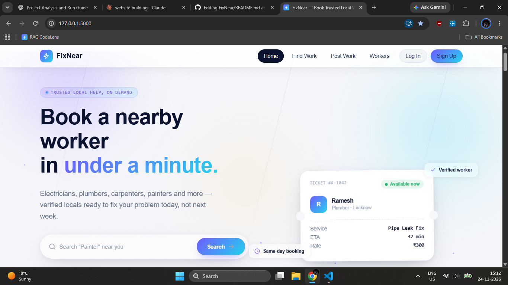
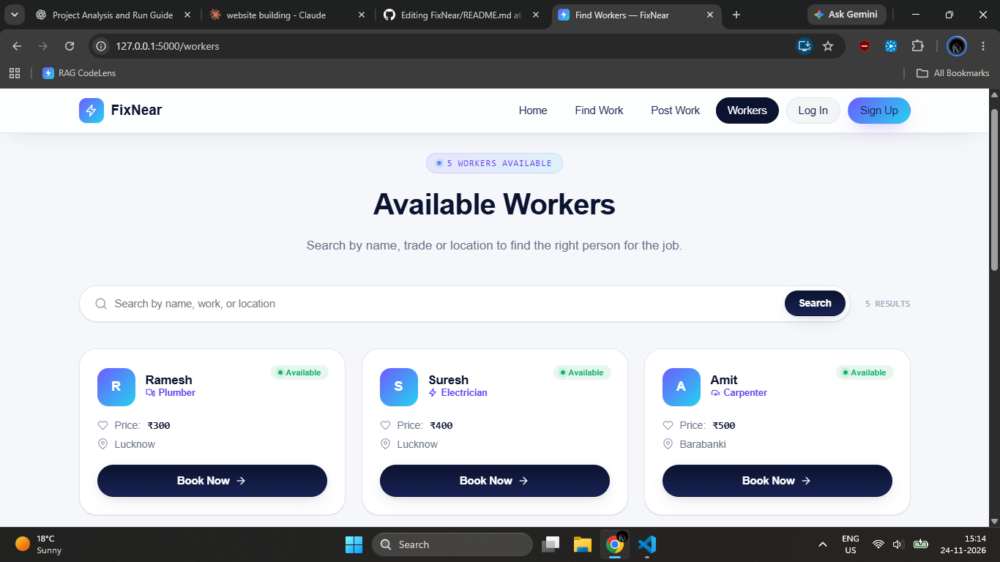
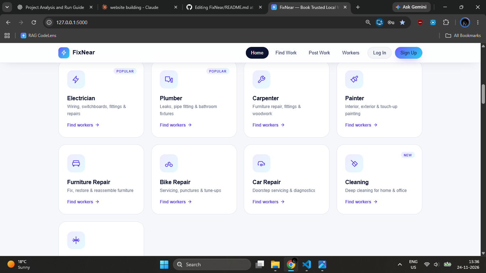
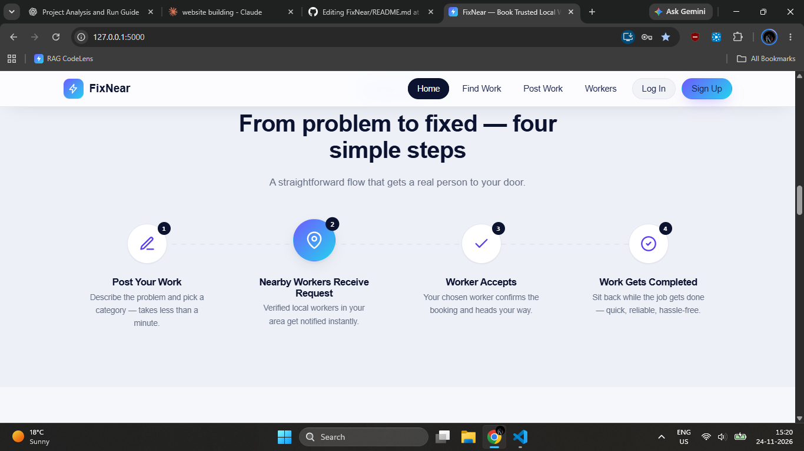
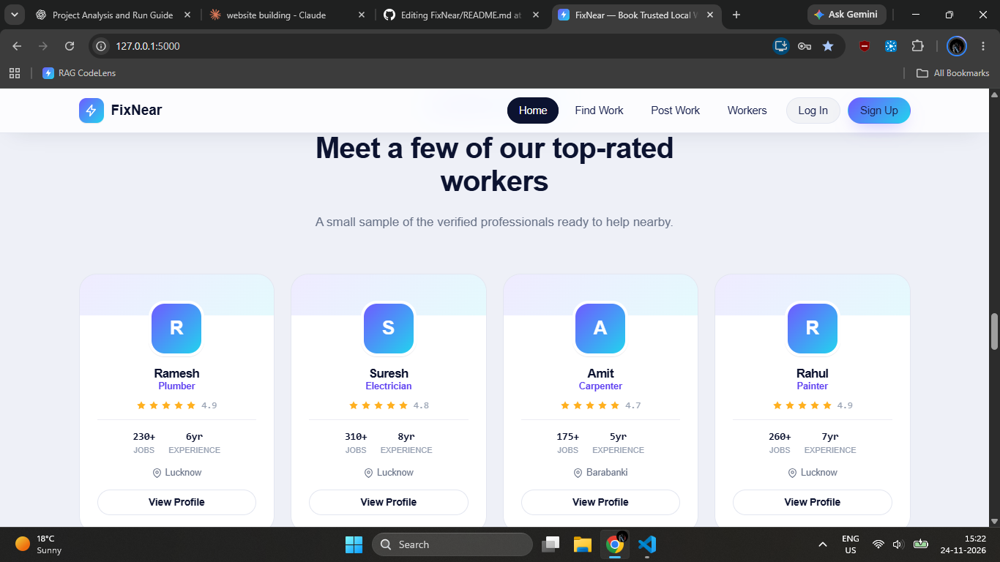

# ⚡ FixNear — Local Worker Booking & Job Marketplace

<p align="center">
  A local service marketplace connecting customers with trusted service providers.
</p>

<p align="center">
  
  
  
  
  
</p>

---

## 📌 About the Project

**FixNear** is a Flask-based local service marketplace designed to connect customers with nearby service professionals such as electricians, plumbers, carpenters, painters, and other skilled workers.

The platform provides two major workflows:

- **Worker Booking:** Customers can discover local service providers and book workers for their requirements.
- **Job Marketplace:** Customers can post jobs, while workers can browse available opportunities and accept suitable jobs.

FixNear provides separate dashboards for customers, workers, and administrators to manage their respective activities.


## 🖥️ Application Preview

### Homepage
[](screenshots/homepage.png)

### Available Workers
[](screenshots/workers.png)

### Popular Services
[](screenshots/services.png)

### How It Works
[](screenshots/how-it-works.png)

### Top-Rated Workers
[](screenshots/top-workers.png)


## ✨ Key Features

### 👤 User Management
- Customer and worker registration.
- Secure login and logout.
- Role-based access control.
- Profile management.
- Admin authentication.

### 🔧 Worker Marketplace
- Browse available local workers.
- Search workers by name, service, or location.
- View worker profiles and service details.
- Check availability, experience, and pricing.
- Book workers for services.

### 📋 Job Marketplace
- Customers can post new jobs.
- Workers can browse available jobs.
- Accept or reject job requests.
- Track job status and history.
- Cancel or complete jobs.
- Save jobs for later.

### 📊 Dashboards
- Customer dashboard for managing bookings and posted jobs.
- Worker dashboard for managing job requests and work activity.
- Admin dashboard for platform management.

### 🔔 Additional Features
- Notifications system.
- Reviews and ratings.
- Job history.
- Secure image upload handling.
- Search, filtering, and pagination.

## 🛠️ Technology Stack

| Technology | Purpose |
|---|---|
| Python | Backend programming |
| Flask | Web application framework |
| Flask-SQLAlchemy | ORM integration |
| SQLAlchemy 2.0 | Database operations |
| Flask-Login | User authentication |
| Flask-WTF | CSRF protection |
| SQLite | Database |
| HTML5 | Page structure |
| CSS3 | Styling and responsive UI |
| JavaScript | Frontend interactions |
| Jinja2 | Template rendering |

## 🏗️ System Architecture

FixNear follows a modular application architecture that separates routing, business logic, database models, and frontend templates.

```text
                 USER
                   |
                   v
          HTML / CSS / JavaScript
                   |
                   v
             FLASK APP
                   |
          +--------+--------+
          |                 |
          v                 v
       ROUTES           AUTHENTICATION
          |
          v
       SERVICES
          |
          v
        MODELS
          |
          v
     SQLALCHEMY ORM
          |
          v
      SQLITE DATABASE
```

### Architecture Highlights

- **Application Factory:** Centralized Flask application creation.
- **Routes:** Handle incoming requests and application navigation.
- **Services:** Contain business logic and database operations.
- **Models:** Define database entities and relationships.
- **Templates:** Render dynamic HTML using Jinja2.
- **Utilities:** Provide reusable decorators, validators, and helper functions.

## 📁 Project Structure

```text
FixNear/
│
├── app/
│   ├── __init__.py
│   ├── config.py
│   ├── extensions.py
│   ├── error_handlers.py
│   ├── logging_config.py
│   ├── seed.py
│   │
│   ├── models/
│   │   ├── user.py
│   │   ├── booking.py
│   │   ├── job.py
│   │   ├── notification.py
│   │   ├── saved_job.py
│   │   ├── review.py
│   │   ├── category.py
│   │   ├── message.py
│   │   └── uploaded_image.py
│   │
│   ├── routes/
│   │   ├── main_routes.py
│   │   ├── auth_routes.py
│   │   ├── profile_routes.py
│   │   ├── job_routes.py
│   │   ├── dashboard_routes.py
│   │   └── marketplace_routes.py
│   │
│   ├── services/
│   │   ├── auth_service.py
│   │   ├── job_service.py
│   │   ├── notification_service.py
│   │   ├── review_service.py
│   │   ├── upload_service.py
│   │   └── booking_service.py
│   │
│   └── utils/
│       ├── decorators.py
│       ├── validators.py
│       └── helpers.py
│
├── instance/
├── migrations/
├── static/
│   ├── uploads/
│   ├── script.js
│   ├── style.css
│   └── favicon.svg
│
├── templates/
├── logs/                 # Local runtime logs
├── app.py
├── run.py
├── requirements.txt
├── .env.example
├── .gitignore
└── README.md
```

## ⚙️ Installation & Setup

### Requirements

- Python 3.10 or higher
- pip
- Git

### 1. Clone the Repository

```bash
git clone https://github.com/shyam979521/FixNear.git
cd FixNear
```

### 2. Create a Virtual Environment

```bash
python -m venv .venv
```

Activate it:

**Windows (PowerShell):**
```powershell
.\.venv\Scripts\Activate.ps1
```

**Linux / macOS:**
```bash
source .venv/bin/activate
```

### 3. Install Dependencies

```bash
python -m pip install -r requirements.txt
```

### 4. Configure Environment Variables

Create your local environment file:

```powershell
Copy-Item .env.example .env
```

For Linux / macOS:

```bash
cp .env.example .env
```

Update `.env` with a strong, unique `SECRET_KEY` and the appropriate configuration values.

Never commit `.env` or expose production credentials.

### 5. Run the Application

```bash
python run.py
```

The application will be available at:

**http://127.0.0.1:5000**

The backward-compatible entry point is also available:

```bash
python app.py
```

## 🗄️ Database Information

FixNear uses SQLite with SQLAlchemy ORM.

The application includes models for:

- Users
- Workers
- Bookings
- Jobs
- Job Applications
- Notifications
- Categories
- Reviews
- Messages
- Uploaded Images
- Saved Jobs

On startup, the application creates missing database tables and initializes default seed data where applicable.

Existing database tables and records are intended to be preserved.

The local SQLite database and runtime logs are not included in the GitHub repository.

## 🔐 Security Features

The project includes several security measures:

- Password hashing using Werkzeug.
- Role-based access control.
- CSRF protection using Flask-WTF on supported POST forms.
- HttpOnly and SameSite session cookie settings.
- Secure session cookies in production configuration.
- File upload extension validation.
- Maximum upload size limit of 5 MB.
- UUID-based filenames for uploaded files.
- Environment-based secret configuration.
- Admin authentication and authorization checks.

**Security note:** Some existing state-changing operations use GET routes. These should be converted to POST requests with CSRF protection before production deployment.

## 🧪 Testing & Current Limitations

The application has undergone manual smoke testing using Flask's test client during development.

The tested workflows include:

- Registration and authentication.
- Customer, worker, and admin access.
- Job creation and acceptance.
- Job cancellation and completion.
- Worker booking.
- Admin booking management.
- Saved jobs and notifications.
- Access-control redirects.

There is currently no formal automated test suite.

Other known limitations:

- The Messages page is currently a frontend preview; real-time messaging is not implemented.
- Forgot-password email delivery is not connected.
- Reviews and ratings need further end-to-end validation.
- Database migrations are not yet fully configured through Flask-Migrate.

## 🚀 Future Roadmap

Planned improvements include:

- [ ] Implement automated testing using Pytest.
- [ ] Integrate real-time messaging.
- [ ] Complete the review and rating workflow.
- [ ] Add email-based password recovery.
- [ ] Introduce Flask-Migrate for database migrations.
- [ ] Migrate from SQLite to PostgreSQL.
- [ ] Improve authentication security and rate limiting.
- [ ] Implement a REST API using Flask Blueprints.
- [ ] Introduce real-time notifications using WebSockets or Server-Sent Events.
- [ ] Improve job application workflows with multi-worker bidding.
- [ ] Deploy the application to a production hosting platform.

## 👨‍💻 Developer

**Shyam Prakash Yadav**

GitHub: [@shyam979521](https://github.com/shyam979521)

LinkedIn: [Shyam Prakash Yadav](https://www.linkedin.com/in/shyam-prakash-yadav/)

---

<p align="center">
  Built with ❤️ using Python and Flask.
</p>

<p align="center">
  ⭐ If you find this project interesting, consider giving it a star!
</p>